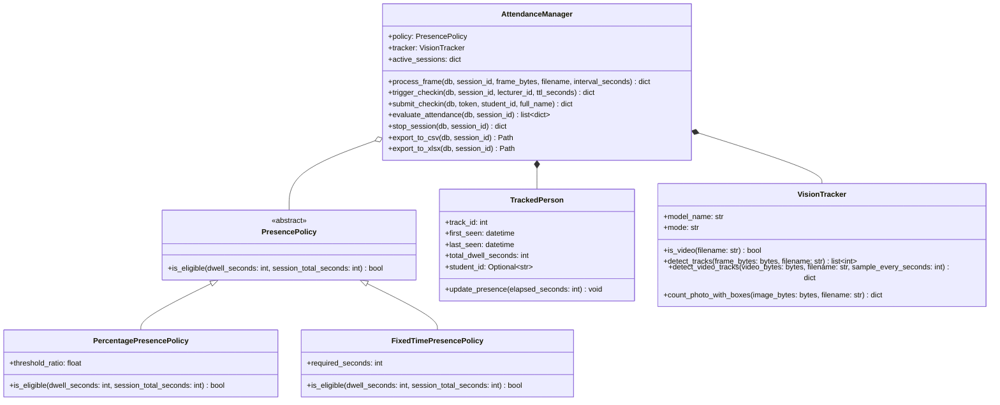
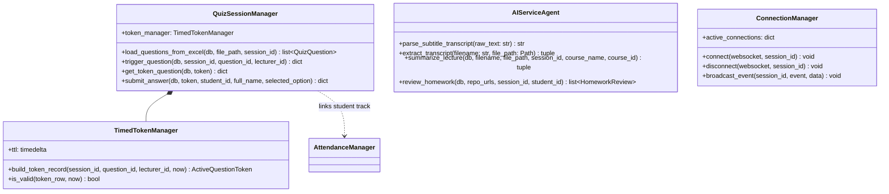
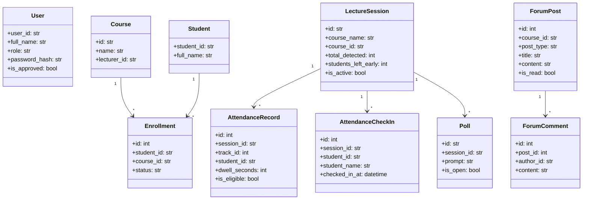

# Class Diagrams & Design Patterns

## 1. Domain Services & Strategy Pattern

---

## 2. Quiz, AI & WebSocket Managers

---

## 3. SQLAlchemy ORM Models

---

## 4. Design Patterns Applied

1. **Strategy Pattern:** `PresencePolicy` (`PercentagePresencePolicy`, `FixedTimePresencePolicy`) decouples attendance eligibility rules from `AttendanceManager`.
2. **Singleton / Process-Scoped Manager:** Module-level `attendance_manager`, `quiz_manager`, `ai_service`, and `ws_manager` hold shared in-memory state within the single Uvicorn worker.
3. **Fallback / Graceful Degradation:** `VisionTracker` falls back to mock tracking only when YOLO/OpenCV cannot load; `AIServiceAgent` falls back from OpenAI/Whisper to `faster-whisper` or explicitly labelled `[Non-LLM Static Analysis]` / `Transcription Unavailable`.
4. **Observer (Pub/Sub) via WebSocket:** `ConnectionManager` broadcasts domain events (`QUIZ_UPDATE`, `POLL_UPDATE`, `FORUM_THREAD_NEW`, `FORUM_COMMENT_NEW`, `STUDENT_MESSAGE_NEW`, `ATTENDANCE_UPDATE`, `ATTENDANCE_DONE`, `SUMMARY_READY`) to subscribed browser clients.
5. **Service Layer Separation:** Routers handle HTTP/validation only and delegate persistence & business rules to `app/services/`.
