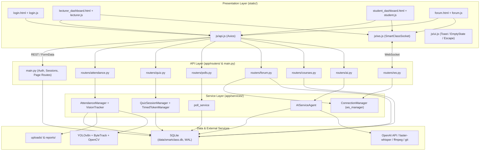

# Component Architecture

## 1. Component Diagram

---

## 2. Component Responsibilities & Interfaces

| Component | File | Responsibility | Key Interfaces |
| :--- | :--- | :--- | :--- |
| **Frontend Controllers** | `static/js/*.js` | Role guards, DOM updates, offline queue (`localStorage`), Chart.js/QRCode.js | Calls `api.*` in `api.js`; subscribes via `SmartClassSocket` |
| **Main App & Auth** | `app/main.py` | Lifespan DB init + seeding, page routes, `/api/auth/login`, `/api/sessions` | `health_check`, `login_or_register`, `get_session_report` |
| **Attendance Router & Manager** | `app/routers/attendance.py`, `attendance_service.py` | Frame/video ingestion, photo counting, self check-in QR, CSV/XLSX export | `process_frame`, `count_photo_with_boxes`, `trigger_checkin`, `export_to_xlsx` |
| **Quiz Router & Manager** | `app/routers/quiz.py`, `quiz_service.py` | `.xlsx` bank import, 300s token issuance & validation, track linking | `load_questions_from_excel`, `trigger_question`, `submit_answer` |
| **Polls Router & Service** | `app/routers/polls.py`, `poll_service.py` | Create, tally, vote, and close 2–4 option polls | `create_poll`, `submit_vote`, `close_poll` |
| **Courses & Forum Routers** | `app/routers/courses.py`, `forum.py` | Course catalog, enrollment approval, roster import, course forum, private inbox | `list_courses`, `import_course_students`, `create_course_post`, `mark_post_as_read` |
| **AI Router & Agent** | `app/routers/ai.py`, `ai_service.py` | `.vtt`/`.srt`/Whisper transcription, chunked summaries, GitHub clone + TF-IDF review | `summarize_lecture`, `review_homework` |
| **WebSocket Manager** | `app/services/ws_manager.py`, `routers/ws.py` | In-memory socket registry by `session_id` / `course:{id}` / `global` | `connect`, `disconnect`, `broadcast_event` |
