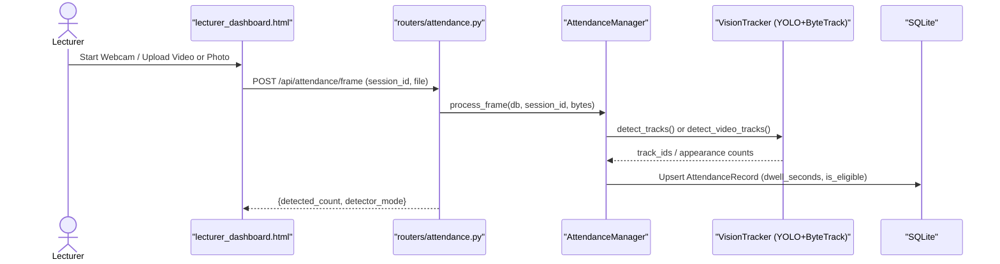
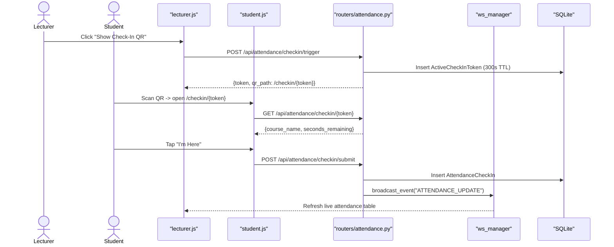
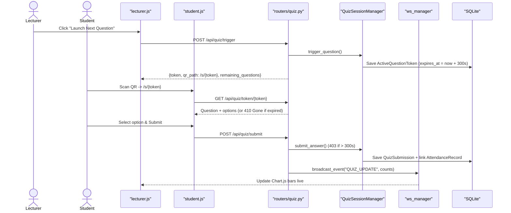
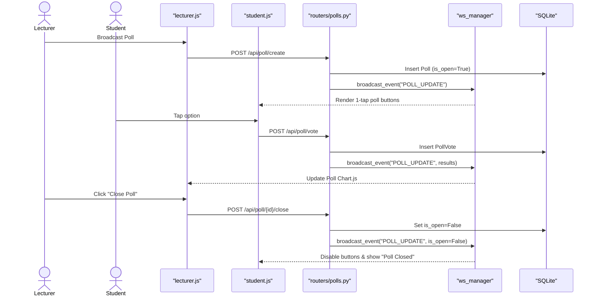
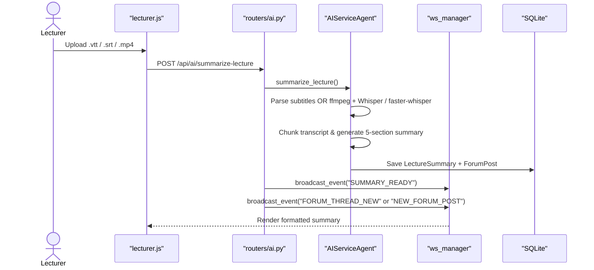
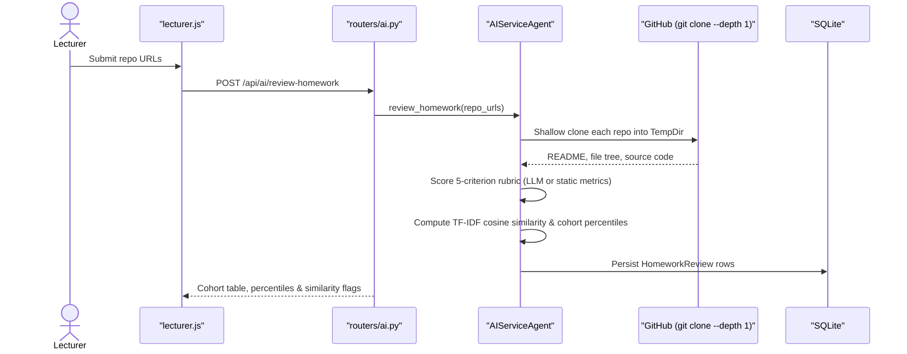
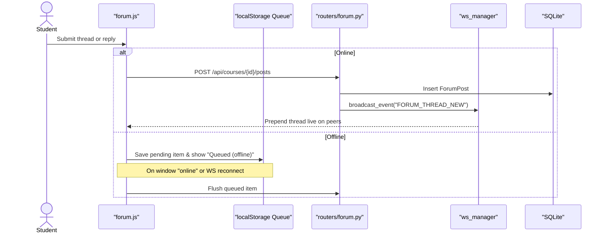

# Sequence Diagrams

## 1. Attendance via Photo / Webcam Frame / Video

---

## 2. Student QR Self Check-In

---

## 3. Quiz Trigger, Scan, Submit & Live Chart Update

---

## 4. Instant Poll: Create, Vote & Close

---

## 5. Lecture Summary (Upload, Transcribe, Summarize & Forum)

---

## 6. Homework Review with Cohort Comparison

---

## 7. Real-Time Course Forum Post & Offline Queue

