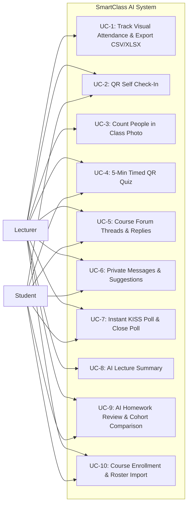

# Use Cases & User Stories

## 1. Use Case Diagram

---

## 2. User Stories & Acceptance Criteria

### F1: Attendance & Timed Quizzes
- **UC-1 (Visual Attendance & Offline Spreadsheet):** *As a Lecturer, I want to stream webcam frames or upload a classroom video and export `.csv`/`.xlsx` attendance so that roll-call takes zero lecture time.*
  - **Acceptance:** Video upload samples frames via OpenCV (`yolo_video`); `.xlsx` contains `student_id, name, checked_in_at, camera_dwell_minutes, presence_status, source`; `/api/sessions/{id}/report` returns `no_data: true` when empty.
- **UC-2 (Student QR Self Check-In):** *As a Student, I want to scan a short-lived QR and tap "I'm Here" so that my presence is recorded without installing an app.*
  - **Acceptance:** `/checkin/{token}` marks attendance, broadcasts `ATTENDANCE_UPDATE`, and appears in live roster & exports as `self_checkin`.
- **UC-3 (Single Photo Student Count):** *As a Lecturer, I want to upload a class photo and immediately see the person count with bounding boxes so that I can verify room headcount in seconds.*
  - **Acceptance:** `POST /api/attendance/count-photo` returns `count`, `boxes`, and annotated image.
- **UC-4 (5-Minute Timed Quiz):** *As a Lecturer, I want to launch Excel questions as 5-minute QR codes so that only students in class can answer.*
  - **Acceptance:** Valid at 299 s, rejected (`403`/`410`) after 300 s; live chart updates via `QUIZ_UPDATE`.

### F2: Comments, Course Forum & Suggestions
- **UC-5 (Real-Time & Offline Course Forum):** *As a Student or Lecturer, I want course threads and replies to appear live and queue offline when Wi-Fi drops so that discussions never lose messages.*
  - **Acceptance:** `FORUM_THREAD_NEW` and `FORUM_COMMENT_NEW` update `forum.js` live; offline posts queue in `localStorage` and flush on reconnect.
- **UC-6 (Private Student Suggestions):** *As a Student, I want to send private suggestions to my lecturer, and as a Lecturer, I want to read and mark them read in my dashboard.*
  - **Acceptance:** `STUDENT_MESSAGE_NEW` updates the lecturer's Student Messages panel; `POST /api/forum/posts/{id}/read` clears unread state.

### F3: Instant KISS Polls
- **UC-7 (Create, Vote & Close Poll):** *As a Lecturer, I want to launch a 1-click poll and close it when discussion moves on so that students see clearly when voting has ended.*
  - **Acceptance:** `POST /api/poll/{id}/close` sets `is_open=false`, broadcasts `POLL_UPDATE`, and blocks further votes (`403`).

### F4: Lecture Summary
- **UC-8 (Transcript & Recording Summarizer):** *As a Lecturer, I want to upload a `.vtt`/`.srt`/`.mp4` recording and get a structured summary published to the course forum.*
  - **Acceptance:** Subtitles retain timestamps; audio uses Whisper/`faster-whisper` or reports `transcription_available: false`; structured summary publishes to the course forum.

### F5: Homework Review
- **UC-9 (Real Repo Review & Cohort Comparison):** *As a Student, I want to submit my GitHub repo for rubric feedback and see how I compare, and as a Lecturer, I want a cohort table with similarity flags.*
  - **Acceptance:** Clones GitHub repos, scores 5 criteria, computes TF-IDF cosine similarity (`>= 0.85` flagged) and cohort percentiles.

### Cross-Cutting: Enrollment & Roster
- **UC-10 (Course Enrollment & Name-Only Roster Import):** *As a Lecturer, I want to approve student enrollment requests or import a CSV/XLSX of student names.*
  - **Acceptance:** `POST /api/courses/{id}/import-students` enrolls students without personal ID numbers.
